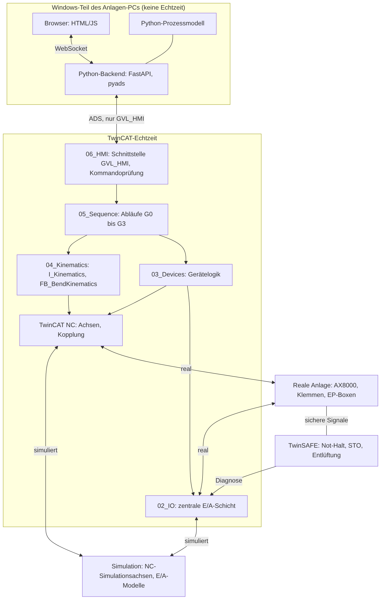

# Softwarearchitektur

Stand: 05.11.2026

Quelle der Abbildung: `abb/architektur.mmd`.

## Schichten

| Ordner | Aufgabe | Gehört nicht hierher |
|---|---|---|
| `00_GVL` | `GVL_HMI`, `GVL_Config`, ab Phase 3 `GVL_IO` | Logik |
| `01_DUT` | Enums und Strukturen | Logik |
| `02_IO` | Füllt logische Eingänge aus Hardware oder Simulation, schreibt Ausgänge | Verriegelungen, Abläufe |
| `03_Devices` | Je Gerät ein Baustein: Achse, Niederhalter, Taster, Leuchte. Freigabe, Reset, Grenzen, Zeitüberwachung | Biegeablauf |
| `04_Kinematics` | Kopplung Z1, X und A über `I_Kinematics` | Betriebsarten, GUI |
| `05_Sequence` | G0 bis G3 als ST-Zustandsautomaten | direkte Camming- oder Prozessabbild-Zugriffe |
| `06_HMI` | Kommandos prüfen und weiterleiten, Status und Alarme einsammeln | Anlagenlogik |
| `07_Test` | TcUnit-Tests | Produktivcode |
| `POUs` | `MAIN` ruft die Schichten in fester Reihenfolge auf | Logik |
| `VISUs` | Optionale einfache TwinCAT-Diagnosevisualisierung | Hauptbedienung |

## Abhängigkeitsregeln

1. Aufrufe laufen nur von oben nach unten: `06_HMI` → `05_Sequence` → `04_Kinematics`, `03_Devices` → `02_IO`.
2. Untere Schichten melden Zustände über Ausgänge oder Status. Sie rufen keine obere Schicht auf.
3. `00_GVL/GVL_Config` und `01_DUT` dürfen alle Schichten nutzen.
4. `GVL_HMI` wird nur von `06_HMI` und `MAIN` genutzt. Bis `06_HMI` existiert, füllt `MAIN` den Status.
5. Nur `02_IO` greift auf `GVL_IO` und das Prozessabbild zu.
6. Nur `04_Kinematics` nutzt Camming- oder Sollwertgenerator-Bausteine.
7. Einzelachsbewegungen laufen über `03_Devices`. Solange eine Achse gekoppelt ist, weist der Achsbaustein sie ab.
8. Sicherheitsfunktionen liegen in TwinSAFE. Die Standard-SPS liest nur Diagnose und Zustand.

## Zuordnung neuer Bausteine

| Frage | Ordner |
|---|---|
| Liest oder schreibt der Baustein Signale direkt? | `02_IO` |
| Kapselt er genau ein Gerät? | `03_Devices` |
| Koordiniert er mehrere Achsen über den Biegeplan? | `04_Kinematics` |
| Entscheidet er über Schrittfolge oder Betriebsart? | `05_Sequence` |
| Übersetzt er zwischen GUI und Steuerung? | `06_HMI` |

## Zyklusreihenfolge in `MAIN`

1. Eingänge lesen (`02_IO`)
2. Kommandos prüfen (`06_HMI`)
3. Abläufe bearbeiten (`05_Sequence`)
4. Kinematik und Geräte bearbeiten (`04_Kinematics`, `03_Devices`)
5. Ausgänge schreiben (`02_IO`)
6. Status und Alarme ausgeben (`06_HMI`)

## Noch festzulegen

- SPS-Zykluszeit: Der Task steht aktuell auf 10 ms, die NC-SAF-Task auf 2 ms. Der endgültige Wert folgt aus Phase 8.
- Rechenort der E/A-Modelle: einfache Modelle in der SPS, aufwendige in Python, wie in der Roadmap vorgesehen.
