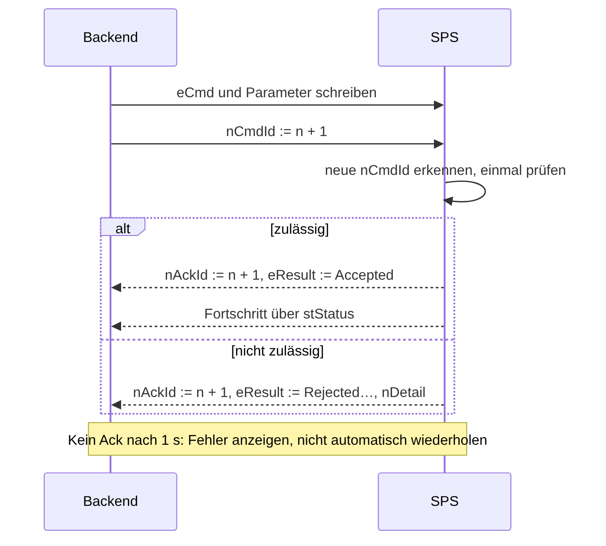

# HMI-Schnittstelle

Stand: 05.11.2026, erste Fassung. Grundlage ist Entscheidung E8.

## Grundregeln

- Das Backend greift nur auf `GVL_HMI.stCmd`, `GVL_HMI.stStatus`, `GVL_HMI.stParam` und `GVL_HMI.stAlarm` zu.
- Die GUI schreibt nur `stCmd` und `stParam`. Die SPS schreibt nur `stStatus` und `stAlarm`.
- Die SPS entscheidet immer. Eine Anzeige in der GUI ist keine Verriegelung.
- Benutzerrollen prüft das Backend. Verriegelungen prüft die SPS.
- Not-Halt und Quittierung laufen über Hardware und TwinSAFE, nicht über die GUI.

| Symbol | Typ | Schreibt | Inhalt |
|---|---|---|---|
| `GVL_HMI.stCmd` | `ST_HmiCmd` | GUI | Kommando, Heartbeat, Tippen |
| `GVL_HMI.stStatus` | `ST_HmiStatus` | SPS | Betriebszustand, Achsen, Niederhalter, E/A |
| `GVL_HMI.stParam` | `ST_HmiParam` | GUI | Parameterwunsch |
| `GVL_HMI.stAlarm` | `ST_HmiAlarms` | SPS | Aktive oder nicht quittierte Alarme |

## Kommandos

Felder: `eCmd`, `eAxis`, `nClamp`, `fPosition`, `fVelocity`, `nValue`.

| Kommando | Wert | Parameter | Phase | Zulässig in |
|---|---:|---|---|---|
| `AlarmAck` | 10 | `nValue`: Slot oder 0 | 6 | allen Betriebsarten |
| `ParamApply` | 11 | `stParam` | 6 | Stillstand, kein Ablauf aktiv |
| `AxisEnable` | 100 | `eAxis` | 4, 6 | Einzelachsen |
| `AxisDisable` | 101 | `eAxis` | 6 | Einzelachsen |
| `AxisReset` | 102 | `eAxis` | 6 | Einzelachsen, Pause |
| `AxisHalt` | 103 | `eAxis` | 4, 6 | Einzelachsen |
| `AxisMoveAbs` | 104 | `eAxis`, `fPosition`, `fVelocity` | 6 | Einzelachsen |
| `ClampOpen` | 120 | `nClamp` | 6 | Einzelachsen |
| `ClampClose` | 121 | `nClamp` | 6 | Einzelachsen |
| `ModePause` | 200 | keine | 6 | Automatik |
| `ModeResume1`, `ModeResume2` | 201, 202 | keine | 6 | Pause |
| `ModeSingleAxis1`, `ModeSingleAxis2` | 203, 204 | keine | 6 | Pause |
| `ModeReturnToBase` | 205 | keine | 6 | Einzelachsen, bei `GZ_POS` |
| `SimSetInput` | 300 | `nValue`, `fPosition` | 5, 6 | nur Simulation |
| `SimInjectFault` | 301 | `nValue` | 5 | nur Simulation |

Für spätere Phasen sind reserviert: `SeqStart` (400), `SeqConfirmQ1` (401), `SeqConfirmQ2` (402), `SeqPartRemoved` (403), `PlanLoad` (410), `MaterialConfirm` (411) und `CalibrateAxis` (500).

Zweistufige Kommandos müssen innerhalb von `GVL_Config.tTwoStepConfirmation` aufeinander folgen. Das erfüllt S3.

Solange Phase 8 fehlt, gilt für Phase 4 eine Ausnahme: `AxisEnable` und `AxisHalt` sind im Simulationsbetrieb ohne Betriebsartenprüfung erlaubt.

## Handshake

| Schritt | Akteur | Aktion |
|---|---|---|
| 1 | Backend | Prüft `nAckId = nCmdId`, sonst ist noch ein Kommando offen |
| 2 | Backend | Schreibt `eCmd` und die Parameter |
| 3 | Backend | Schreibt danach `nCmdId + 1` in einem eigenen Zugriff |
| 4 | SPS | Erkennt die neue ID und prüft das Kommando genau einmal |
| 5 | SPS | Setzt `eResult`, `nDetail` und zuletzt `nAckId` |
| 6 | Backend | Wartet bis zu 1 s auf `nAckId` und meldet das Ergebnis |

`Accepted` heißt nur, dass das Kommando angenommen wurde. Den Fortschritt zeigt `stStatus`.

Regeln:
- Eine gleiche `nCmdId` wird nicht erneut ausgeführt.
- Ohne Antwort nach 1 s meldet das Backend einen Fehler und wiederholt nicht automatisch.
- Beim Start liest das Backend `nAckId` und setzt `nCmdId` darauf.
- Springt `nLifeCounter` zurück, gilt die SPS als neu gestartet. Das Backend synchronisiert sich dann neu.

## Tippen

Tippen läuft über `stCmd.stJog`, nicht über den Handshake.

- Die GUI setzt `eAxis`, `nDirection` und `fVelocityFactor_pct`.
- Beim Loslassen setzt sie `nDirection := 0`.
- Die SPS bewegt nur in Betriebsart Einzelachsen und bei lebendem Heartbeat.
- Bei Timeout, Betriebsartwechsel oder Verriegelung stoppt die Achse.

## Heartbeat

| Größe | Startwert |
|---|---|
| Browser-Ping an das Backend | alle 100 ms |
| Backend-Timeout für den Browser | 300 ms |
| Backend erhöht `nHeartbeat` | alle 100 ms |
| SPS-Timeout `tHeartbeatTimeout` | 500 ms |

Das Backend zählt nur weiter, solange der Browser antwortet. So fällt auch ein geschlossenes Browserfenster auf.

Bei SPS-Timeout gilt:
- `bHmiAlive := FALSE`
- Alarm `HmiHeartbeatLost`
- Tippen und Einzelbewegungen stoppen
- Automatik geht in Pause, weil die Bedienung sonst keinen Eingriff mehr hätte

Die Werte werden in Phase 4 gemessen und angepasst. Bei langsamer ADS-Antwort darf der Timeout nicht zu Fehlauslösungen führen.

## Status

| Feld | Bedeutung |
|---|---|
| `nLifeCounter` | Lebenszeichen der SPS |
| `bHmiAlive`, `bSimulation` | Heartbeat und Betriebsart Simulation |
| `bEStopActive`, `bSafetyOk` | Not-Halt und Safety-Zustand |
| `eMode` | Betriebsart nach G1 |
| `nStepG2`, `nStepG3`, `nBend` | Fortschritt |
| `dwBaseStateMissing` | Fehlende Grundzustandsbedingungen |
| `stCmdAck` | Antwort auf das letzte Kommando |
| `aAxis[1..5]` | Index nach `E_Axis`: Z1, Z2, X, A, W |
| `aClamp[1..6]` | Niederhalter 1 bis 6 |
| `stIo` | Druckschalter und Bedienfeld-E/A |
| `stKin` | Zustand der Kinematik |
| `stParamActive` | Aktiv übernommene Parameter |

### Je Achse

`eState`, `bEnabled`, `bReady`, `bError`, `nErrorId`, `fActPos`, `fSetPos`, `fActVelo`, `fSetVelo`, `fLagError`, `fTorque_Nm`.

### Je Niederhalter

`eState`, `bValve`, `bOpen`, `fLastSwitchTime_ms`. Eine Rückmeldung „geklemmt“ gibt es nicht. `Clamped` bedeutet: Endlage OFFEN verlassen, Druck in Ordnung und Schaltzeit abgelaufen.

### `dwBaseStateMissing`

| Bit | Fehlende Bedingung |
|---|---:|
| 0 | Z1 nicht in Null-Position |
| 1 | Z2 nicht in Null-Position |
| 2 | X nicht in Null-Position |
| 3 | A nicht in Null-Position |
| 4 | W nicht in Null-Position |
| 5 | Niederhalter nicht alle offen |
| 6 | Fehler aktiv |
| 7 | Safety nicht bereit |
| 8 | Kein Programm geladen |
| 9 | Material nicht bestätigt |

## Parameter

| Feld | Einheit | Zweck |
|---|---|---|
| `nPlanId` | – | Aktiver Biegeplan |
| `stMaterial.fDiameter_mm` | mm | Außendurchmesser |
| `stMaterial.fWall_mm` | mm | Wandstärke, 0 bei Vollmaterial |
| `stMaterial.fYield_MPa` | MPa | Rp0,2 |
| `stMaterial.fForceLimit_N` | N | Kraftgrenze Z1 |
| `fFeedOverride_pct` | % | Vorschub-Override |
| `fSingleAxisVelo_pct` | % | Einzelachsgeschwindigkeit |

Ablauf: Die GUI schreibt `stParam` und sendet `ParamApply`. Die SPS prüft den Satz und kopiert ihn nach `stStatus.stParamActive`. Nur die aktive Kopie wirkt.

Die SPS begrenzt `fForceLimit_N` zusätzlich auf 25 kN. Die zulässigen Antriebsmomente liegen als Schutzparameter im AX8000 und können über die GUI nicht erhöht werden.

Der Biegeplan selbst wird noch nicht übertragen. Ein Übergabebereich in `GVL_HMI` folgt in Phase 9. Phase 8 nutzt einen fest eingetragenen Plan.

## Alarme

`stAlarm` enthält bis zu 32 Einträge. Texte und Historie liegen im Backend.

| Feld | Bedeutung |
|---|---|
| `eCode` | Alarmcode |
| `eSeverity` | `Info`, `Warning`, `Stop`, `Fault` |
| `nSource` | Achse oder Niederhalter |
| `nDetail` | Zusatzwert, etwa NC-Fehlercode |
| `nTimestamp` | Zeitstempel |
| `bActive` | Ursache besteht noch |
| `bAcked` | Quittiert |

Ein Eintrag entfällt, wenn die Ursache behoben und der Alarm quittiert ist. `nChangeCounter` steigt bei jeder Änderung. `bOverflow` zeigt an, dass Einträge fehlen.

| Stufe | Reaktion |
|---|---|
| `Info` | Anzeige |
| `Warning` | Anzeige, Ablauf läuft weiter |
| `Stop` | Pause |
| `Fault` | Pause, Wiederanlauf erst nach Behebung |

Die Toleranzen und Zuordnungen zu den Stufen sind nach SE3 noch festzulegen.

## Offene Punkte

- Belegung von ED1809, ED2809 und deren Vorrang gegenüber der GUI
- Zweck von EL6001 und EL6021
- Rechtekonzept Bediener und Einrichter
- Gemessene Zeiten für Heartbeat und ADS
- Kommandos für Kamera und Datenaufzeichnung
