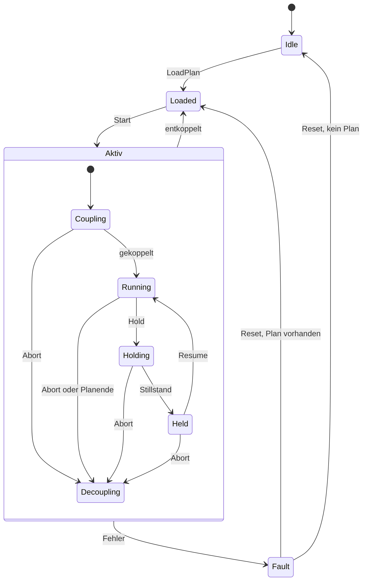

# Kinematik

Stand: 05.11.2026. Grundlage ist Entscheidung E6.

## Ziel

Der Ablauf kennt nur `I_Kinematics`. Die erste Umsetzung `FB_BendKinematics` nutzt NC Camming mit Z1 als Master. Eine spätere Umsetzung mit externen Sollwerten ersetzt nur diesen Baustein.

Der aktuelle Rumpf bewegt keine Achsen und enthält keine Camming-Bausteine.

## Interface

| Methode | Rückgabe | Wirkung | Zulässig in |
|---|---|---|---|
| `Cyclic()` | – | Einmal pro SPS-Zyklus | immer |
| `LoadPlan(nPlanId)` | `BOOL` | Plan laden | `Idle`, `Loaded` |
| `Start()` | `BOOL` | An der aktuellen Masterposition koppeln, Master starten | `Loaded` |
| `Hold()` | `BOOL` | Master gesteuert anhalten | `Running` |
| `Resume()` | `BOOL` | Master fortsetzen | `Held` |
| `Abort()` | `BOOL` | Stoppen, entkoppeln | `Coupling`, `Running`, `Holding`, `Held` |
| `Reset()` | `BOOL` | Fehler quittieren, Plan bleibt erhalten | `Fault` |
| `GetStatus()` | `ST_KinStatus` | Status lesen | immer |

Methoden nehmen nur Aufträge an. `TRUE` heißt nicht, dass die Bewegung fertig ist. Das Ergebnis steht im Status.

## Zustände



| Modus | Zustände | Bedeutung |
|---|---|---|
| `Single` | `Idle`, `Loaded`, `Decoupling`, `Fault` | Keine laufende Kopplung. Einzelachsbewegung über `FB_Axis` nur in `Idle` und `Loaded` |
| `Coupled` | `Coupling`, `Running` | Master läuft oder fährt an |
| `Hold` | `Holding`, `Held` | Master bremst oder steht, Kopplung bleibt |

## Zuordnung der Achsen

| Achse | Rolle |
|---|---|
| Z1 | Master |
| X | Slave, Tabelle u(s) |
| A | Slave, Tabelle φ(s), unabhängig von X |
| W | Einzelbewegung in G3, simultaner Betrieb später als weiterer Slave |
| Z2 | Während des Bogens fest, Wert je Biegung |

Für Z2 gilt die Empfehlung aus Prüfbericht H5. Sie ist noch mit Thomas zu bestätigen.

## Verhalten

| Ereignis | Kinematik | Ablauf | Wiederanlauf |
|---|---|---|---|
| Pause | `Hold()`, Slaves folgen dem Master | G2 und G3 eingefroren | Zweistufig, dann `Resume()` |
| G3 Rotation | `Hold()`, nach `Held` dreht W | G2 eingefroren | `Resume()` |
| Warnung | Keine Änderung | Anzeige | – |
| Alarm `Stop` | `Hold()` | Pause | Wie Pause |
| Achsfehler Master | Wechsel nach `Fault`, Master stoppen | Pause | `Reset()`, Prüfung, zweistufige Bestätigung, `Start()` |
| Achsfehler Slave | Master sofort stoppen, `Fault` | Pause | `Reset()`, Prüfung, zweistufige Bestätigung, `Start()` |
| GUI-Ausfall | `Hold()` | Pause | Nach Rückkehr wie Pause |
| Not-Halt | Antriebe durch STO abgeschaltet, `Fault` | G0 erzwingt Pause, Programmzustand bleibt | Quittierung, `Reset()`, Prüfung, zweistufige Bestätigung, `Start()` |

## Wiederanlauf nach Not-Halt oder Fehler

Der Ablauf ruft `Start()` nur auf, wenn alle Bedingungen erfüllt sind:

1. Safety ist wieder bereit, und alle Achsen sind fehlerfrei.
2. Die benötigten Niederhalter wurden neu geklemmt, denn die Pneumatik wurde entlüftet.
3. X, A, W und Z2 liegen zur Masterposition innerhalb der Toleranz. A und W sind nicht selbsthemmend und können sich bewegt haben.
4. Der Bediener hat den Wiederanlauf zweistufig bestätigt.

Bei zu großer Abweichung wird `KinPositionDeviation` gesetzt. Eine automatische Ausgleichsbewegung gibt es nicht, weil sie das belastete Rohr verformen könnte.

`Reset()` behält den Plan, damit das Programm am unterbrochenen Schritt fortgesetzt werden kann (S2). `Start()` koppelt dann an der aktuellen Masterposition. Ob die NC das nach STO genau so erlaubt, wird in Phase 8 geprüft.

## Prüfungen in Phase 8

- Wie reagiert der Master auf einen Slave-Fehler in der NC?
- Wie groß darf eine Cam-Tabelle sein, und wie wird sie zur Laufzeit geladen?
- Bleibt die Kopplung bei `Hold()` ruckfrei und ohne Sprung beim Wiederanlauf?
- Wie wird der Vorschub-Override auf den Master angewendet?
- Sind die Spitzenwerte der Slaves auch beim Anhalten des Masters zulässig?

## Biegeplan

Anforderungen an das Format:

| Bereich | Inhalt |
|---|---|
| Kopf | Formatversion, Plan-ID, Name, Erstellungsdaten |
| Material | Durchmesser, Wandstärke, Werkstoff, Rp0,2, Kraftgrenze |
| Stützstellen | Vorschubweg s mit u(s), φ(s), optional W(s) |
| Je Biegung | Z1_start, Z1_fin, Z2, NH_soll |
| Niederhalter | Schaltpunkt z_NH,i je Niederhalter |
| Rotation | Z1_rot,k und W_rot,k |

Regeln:
- Der Plan ist eine Funktion des Vorschubwegs s, und s steigt streng monoton.
- Anbiegen, stationärer Bereich und Rückbiegen liegen im gekoppelten Abschnitt (H4).
- X und A haben eigene Verläufe. Ihr Verhältnis ist nicht fest (Dok. 01, Abschnitt 4).
- Z2 ist je Biegung konstant (H5).
- Einheiten sind mm und °.

Vor dem Laden werden geprüft:
- Verfahrwege und Software-Endlagen
- Geschwindigkeit und Beschleunigung aller Achsen, vor allem X (K4)
- Kraftgrenze aus dem Material (H2)
- Niederhalter-Schaltpunkte, Vorlauf und freie Rohrlänge (H3, H8)
- Abstand dZ12
- Netto-Drehung von W (H6)

Beispiel für die Struktur, keine freigegebenen Prozesswerte:

```json
{
  "format": 1,
  "plan_id": 1,
  "name": "Beispiel",
  "material": {
    "diameter_mm": 15.0,
    "wall_mm": 2.0,
    "yield_mpa": 300.0,
    "force_limit_n": 16000.0
  },
  "bends": [
    {
      "z1_start_mm": 100.0,
      "z1_fin_mm": 220.0,
      "z2_mm": 0.0,
      "clamps": [1, 2, 3, 4, 5, 6],
      "clamp_open_mm": [150.0, 150.0, 180.0, 180.0, 210.0, 210.0],
      "points": [
        {"s_mm": 100.0, "u_mm": 0.0, "phi_deg": 0.0},
        {"s_mm": 140.0, "u_mm": 7.0, "phi_deg": 32.52},
        {"s_mm": 180.0, "u_mm": 7.0, "phi_deg": 32.52},
        {"s_mm": 220.0, "u_mm": 0.0, "phi_deg": 0.0}
      ],
      "rotations": []
    }
  ]
}
```
